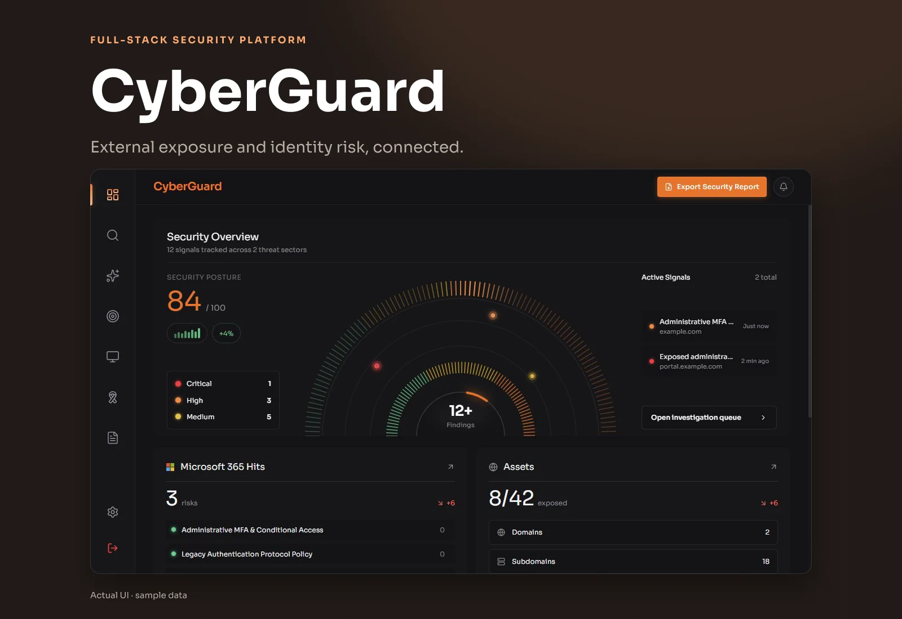

# CyberGuard — Backend



The FastAPI service behind CyberGuard, a security-management platform for external attack surface visibility and Microsoft 365 identity/configuration findings. The [Next.js frontend](https://github.com/Trine-Labs/cyberguard-frontend) consumes this API.

## Responsibilities

- Tenant/user records, JWT sessions, verification, and administration
- Onboarding, scopes, and ownership verification
- External asset discovery, service/port and certificate inspection, and exposure findings
- Microsoft 365 OAuth, Graph collection, synchronization, and configuration checks
- Findings queries/status management, dashboard summaries, and scan history
- AI-assisted explanations and executive synthesis
- Phishing-awareness campaigns, activity, and employee scores
- PDF security-report generation

Scanning and awareness workflows operate on an organization's authorized scope. AI explanations summarize findings; they do not establish independent verification or remediation.

## Architecture

**Python 3.11 · FastAPI · Pydantic · PostgreSQL · async SQLAlchemy/asyncpg · Alembic · Celery · Redis**

Microsoft Graph integrations use HTTPX. Fernet supports credential encryption, JWT supports sessions, dnspython supports DNS verification, and ReportLab generates reports. Scanner modules integrate service probes and optional external tools/providers.

- app/main.py: lifecycle, middleware, routers, and health endpoints
- app/routers/: auth, onboarding, dashboard, EASM, Microsoft 365, findings, settings, phishing, and administration
- app/models/ and app/schemas/: persistence and API contracts
- app/services/easm/: discovery and exposure scanning
- app/services/m365_*: Graph integrations
- app/services/ai_analyst.py: AI synthesis
- app/worker.py and app/tasks/: background and scheduled jobs
- migrations/: Alembic history
- tests/: EASM and Microsoft 365/SSPM tests

## Local setup

Create a Python 3.11 environment and install the pinned dependencies:

```bash
python -m venv .venv
# Activate .venv using your shell.
python -m pip install -r requirements.txt
cp .env.example .env
```

On Windows PowerShell, use `.\.venv\Scripts\Activate.ps1` and `Copy-Item .env.example .env`.

Provide development PostgreSQL and Redis instances. Configure .env with:

- DATABASE_URL: async PostgreSQL URL (postgresql+asyncpg://...)
- JWT_SECRET_KEY and FERNET_ENCRYPTION_KEY: generated application-specific secrets
- REDIS_URL, CORS_ORIGINS, and FRONTEND_URL
- Microsoft 365 app ID, secret, redirect URI, and Graph scopes when enabling that integration
- SMTP settings for email flows
- AI and scanner-provider settings for optional integrations

Override deployment credentials through the environment rather than relying on development defaults. Keep .env out of Git.

For a new, disposable development database, initialize models and start the API:

```bash
python init_db.py
uvicorn app.main:app --reload --host 127.0.0.1 --port 8000
```

Review Alembic history when upgrading an existing database; initialization is not a backup or universal upgrade procedure.

Start worker and scheduler processes for background jobs:

```bash
celery -A app.worker.celery_app worker --loglevel=info
celery -A app.worker.celery_app beat --loglevel=info
```

The API can fall back to an in-memory response cache when Redis is unavailable; that does not replace Redis as the Celery broker. Some scanning features need optional binaries, templates, credentials, or platform-specific dependencies. Review Dockerfile against the actual checkout before using it as a complete deployment recipe.

## API and tests

Documentation: [localhost:8000/docs](http://localhost:8000/docs); ReDoc: /redoc. Health endpoints: /health, /api/health, and /api/v1/health.

```bash
python -m pytest
```

Tests use the configured PostgreSQL connection and create fixture records. Point DATABASE_URL at a separate test database before running them. This documentation update does not imply that infrastructure-dependent tests were executed.
